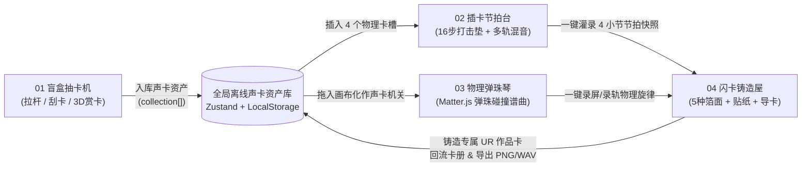

# 《声卡造物局（HoloBeat Studio）》产品架构与全站 Design System 规范

> **参赛方向**：新锐设计华灿奖 · 创意赛道 · 数字媒体方向  
> **设计语言**：**Neo-Brutalism 潮玩掌机实体面板 × 3D 彩虹全息镭射闪卡（Matte Hardware vs. Iridescent Holo）**  
> **一句话产品定义**：把中国市井烟火气与街头声音装进可抽取、可插槽编曲、可物理碰撞、可自定义铸造的 3D 全息声音闪卡，打造零门槛的桌面级潮流声音玩具。

---

## 一、 核心玩法闭环与跨页联动架构

本应用绝非 4 个割裂的功能演示页，而是一条首尾相连的 **「抽卡收集 → 编曲造音 → 物理谱曲 → 铸造收藏」** 潮玩创作闭环，由全局 `Zustand` 离线数据总线实时串联：

### 市井趣味全息声音闪卡世界观（首发 16 张图鉴体系）

为了在华灿奖评审中兼顾 **东方市井文化温度** 与 **赛博潮流交互感**，每张全息声卡自带：**唯一编号、4 轨音色分类、稀有度（`N / R / SR / SSR / UR`）、3 层矢量 SVG 插画、专属全息箔面默认材质、100% 程序化 Tone.js 合成配方**。

| 音色轨类（对应主题色） | 代表市井声卡示例（每类 4 张，共 16 张） | 程序化 Web Audio 离线合成思路 |
| :--- | :--- | :--- |
| **BEAT 街头律动**（电光紫 `#7C3AED`） | `#01 弄堂竹板梆子`、`#02 老式街机拍键`、`#03 糖炒栗子爆壳`、`#04 舞狮咚咚大鼓` | `MembraneSynth` 音高包络下潜 + 高通 `NoiseSynth` 脆裂瞬态 |
| **PERC 市井脆响**（柿子橙 `#FF5C2B`） | `#05 二八大杠车铃`、`#06 冰镇汽水拉环`、`#07 麻将碰杠脆碰`、`#08 货郎拨浪鼓` | 双频 `MetalSynth` 铃声谐波 / 带通白噪嘶啦脉冲 / 木质共振滤器 |
| **MELODY 霓虹旋律**（薄荷青 `#00D4AA`） | `#09 8-Bit 街机投币`、`#10 糖画铜勺叮当`、`#11 赛博古筝拨弦`、`#12 摩天轮八音盒` | `PolySynth` 方波/三角波 + `PluckSynth` 卡尔普斯-斯特朗拨弦（锁定五声调式） |
| **VIBE 烟火氛围**（柠檬黄 `#FFD60A`） | `#13 夜市铁板滋啦`、`#14 梅雨铁皮雨棚`、`#15 港风霓虹电流`、`#16 晚风胡同蝉鸣` | 粉红/布朗噪声 + LFO 慢速扫频带通滤波 + 柔和立体声延迟 |

> **新手零门槛保障**：首次进入应用时，系统默认预置 **4 张基础新手声卡（每类 1 张，保证 02/03 页开箱即可直接演奏）**，其余 12 张稀有/史诗/传说市井声卡通过 `01 盲盒抽卡机` 免费无限抽取（内置保底机制：每 3 抽必出 `SR+`，每 5 抽必出 `SSR/UR`），同时在 `04 铸造屋` 可无限铸造用户的自定义 `UR` 作品卡！

---

## 二、 全局导航栏与 4 大页面功能架构

### 00 全局锁定顶部导航栏（Global Top Navbar — 4 页 100% 一致）
- **固定高度**：`72px`（桌面 16:9 视口下占顶部黄金比例，不遮挡操作区）。
- **三段式精准排布**：
  1. **左侧品牌铭牌**：迷你斜放全息闪卡徽标（带微弱彩虹光泽）+ 粗体几何字标 `HOLOBEAT` + 实体标签胶囊 `声卡造物局`。
  2. **居中 4 页实体分段切换器（Segmented Switcher）**：包裹在浅燕麦色凹槽底座（`#EDE7D9`，`2.5px` 粗描边）内，4 个带编号的立体按键：
     - `01 盲盒抽卡`（选中态：电光紫 `#7C3AED` 底 + 白色粗字）
     - `02 插卡节拍`（选中态：柿子橙 `#FF5C2B` 底 + 白色粗字）
     - `03 物理弹珠`（选中态：薄荷青 `#00D4AA` 底 + 深炭黑粗字）
     - `04 闪卡铸造`（选中态：柠檬黄 `#FFD60A` 底 + 深炭黑粗字）
  3. **右侧全局硬件状态舱**：
     - **图鉴收集胶囊**：`卡库 04/16`（点击展开右侧抽屉快速预览或直达卡册）；
     - **迷你 OLED 节拍监测窗**（深炭黑 `#181820` 底）：实时显示全局 `BPM 120` 与 6 根跳动迷你电平柱（跨页保持背景节拍可视化）；
     - **全局一键静音/发声开关**：方形潮玩实体键（`40×40px`），随时静默或唤醒总音频总线。

---

### 页面 01：盲盒抽卡机（`01 盲盒抽卡机 · GACHA`）
- **页面主目标**：提供极致多巴胺与“开盲盒实体爽感”的声音收集体验，并将 3D 全息闪卡作为开屏第一视觉冲击。
- **三栏实体机台布局（16:9 桌面端一屏呈现，无纵向滚动条）**：
  - **左区（约 34% 宽）· 拟物潮玩扭蛋盲盒机**：
    - 柠檬黄 `#FFD60A` 与象牙白 `#FFFDF8` 双拼机壳 + 顶部发光招牌 `HOLO GACHA` + 透明盲盒橱窗（内含 3D 风格彩色扭蛋球与悬浮迷你全息卡剪影）；
    - **右侧拟物机械大摇杆（Pull Lever）**：支持点击或鼠标往下拖拽拉杆触发棘轮音效与开盒动画；
    - 底部大型柿子橙主按钮 `拉杆抽卡 PULL` + 辅助按钮 `一键十连 / 快速刮开` + 盲盒保底进度条（`SSR PITY 3/5`）。
  - **中区（约 40% 宽）· 全息闪卡核心展示台（全屏视觉焦点）**：
    - 深炭黑哑光陈列底座（`#181820`）衬托正中央超大 **3D 全息声音闪卡（`280×392px`）**，拥有强烈彩虹镭射反光与鼠标跟随 3D 透视倾角；
    - 刚抽出的新卡默认覆盖银色斜纹 **刮刮乐涂层（Scratch-to-Reveal Canvas）**，用户按住鼠标刮开（配沙沙纸面音效），刮开 `≥42%` 自动爆裂显形 + 发射 `canvas-confetti` 音符星芒礼花；
    - 卡片下方提供 3 个实体操作键：`▶ 试听声卡`、`↗ 装入节拍台`、`✨ 翻转查看音色参数`。
  - **右区（约 26% 宽）· 声卡档案与近期卡盒**：
    - 上半部：当前展示声卡的 **市井声音卡片情报**（稀有度大徽章、音色分类标签、实时发声波形示波器、市井风味一句话介绍）；
    - 下半部：可切换的 **已收集声卡迷你卡池（2×3 网格）**，点击任意已抽卡片立即切换至中央 3D 展示台赏玩试听。

---

### 页面 02：插卡节拍台（`02 插卡节拍台 · BEAT DECK`）
- **页面主目标**：像 Teenage Engineering 掌机与卡带游戏机一样，将抽到的 4 张全息声卡插入顶部实体卡槽，零门槛点亮 16 步打击垫并拧动旋钮现场打碟混音。
- **上下掌机布局（左中右紧凑分区，16:9 零滚动一屏全控）**：
  - **顶部控制与波形条（约 14% 高）**：
    - 左侧走带控制组：`▶ 播放/暂停`、`■ 停止`、`● 灌录铸卡（直送04页）`；
    - 中间 **深炭黑 OLED 实时频谱波形屏** + 调式锁选择胶囊（`五声 C` / `霓虹小调` / `爵士`）；
    - 右侧节拍参数组：`BPM 120` 步进微调推杆 + `SWING` 摇摆旋钮 + **一键市井预设切换**（`胡同早市` / `赛博夜市` / `街机厅` / `随机灵感` / `清空`）。
  - **核心主台（约 86% 高，左右两区联动）**：
    - **左侧/上方 · 4 大全息声卡物理插槽 + 多轨混音台（4 行对应 4 轨）**：
      - 每条轨道最左侧是一个 **拟物卡带式全息声卡插槽**：插入后的全息闪卡以微缩卡面呈现并保留彩虹镭射高光条（点击卡槽弹出抽屉自由更换已收集声卡，插卡播放清脆锁紧音效）；
      - 紧邻卡槽是该轨的 **紧凑混音模块**：独立 `M`（静音）/ `S`（独奏）键、实体触感旋钮（`PITCH / TONE` 音高滤波）、垂直或横向音量推子（`VOL`）；
    - **右侧主体 · 16 步进发光打击垫矩阵（4 行 × 16 列）**：
      - 每一行对应对应轨道的高饱和色（轨1电光紫、轨2柿子橙、轨3薄荷青、轨4柠檬黄），每 4 拍一组做清晰节奏节拍分组；
      - 激活的打击垫呈现发光厚实键帽样式，支持点击与鼠标按住连续涂抹；播放头扫过当前列时触发底部指示灯柱与按键弹性弹跳；
    - **底部快捷特效条（Live FX Bar）**：3 个按住生效的 DJ 现场效果垫（`BITCRUSH 像素碎音`、`ECHO 弄堂回声`、`STUTTER 鬼畜切拍`），赋予强烈街头打碟爽感。

---

### 页面 03：物理弹珠琴（`03 物理弹珠琴 · PINBALL SYNTH`）
- **页面主目标**：把声音变成肉眼可见的物理重力游戏——摆放全息声卡方块、高弹弹簧和旋转风车，放开弹珠自动坠落弹跳，在碰撞与几何光环爆发中谱出永动循环乐曲。
- **左侧工具坞 + 中央超大物理画布 + 右侧参数/录制舱（16:9 全屏沉浸）**：
  - **左区（约 22% 宽）· 声卡机关百宝箱（Toolbelt）**：
    - **机关类型切换**：4 个清晰粗描边元件卡片（可点击选中后在画布放置，或直接拖入画布）：
      1. `声卡斜板 BLOCK`（反弹发声，可调倾角）
      2. `弹性弹簧 BUMPER`（高弹蘑菇桩，撞击触发重音）
      3. `旋转风车 SPINNER`（风车拨片，连续分流触发拨弦）
      4. `循环传送门 PORTAL`（底部接球传回顶部，实现永动循环）
    - **绑定声卡选择器**：横向/两列展示已收集的带全息高光条迷你声卡，选中哪张声卡，新放置或选中的机关就绑定该卡音色与色彩！
    - **一键场景预设**：`永动八音盒`、`夜市弹珠台`、`混沌瀑布`、`清空画布`。
  - **中区（约 56% 宽）· Matter.js 2D 物理弹珠画布（视觉主舞台）**：
    - 浅燕麦微点阵网格底板（`#EDE7D9`）+ `3px` 深炭黑粗边框 + 顶部导轨上可左右拖拽的 **拟物弹珠发射器（Dropper）**；
    - 画布中摆放的声卡方块表面绘制彩虹斜向镭射高光，每次与彩色高饱和弹珠碰撞瞬间：方块亮起果冻缩放动画、释放 Mikutap 风格 **粗描边扩散几何圆环 + 星芒射线 + 漂浮音符标识**；
    - 点击画布中任意已有机关可弹出迷你浮标进行 **旋转角度（-45°~+45°）、切换音高、删除**。
  - **右区（约 22% 宽）· 物理控制台与录轨面板**：
    - 核心控制大键：`▼ 发射单颗弹珠 DROP`、`▶ 开启/暂停自动连发 AUTO`；
    - 物理旋钮与滑块：`GRAVITY 重力`（月球慢飘到超重急坠）、`DROP RATE 发射速率`（同步 BPM 节拍）、`BOUNCE 弹性系数`、`SCALE 调式锁`（五声/大调/小调）；
    - 底部 **碰撞实时乐谱/录音模块**：显示当前碰撞连击数与活性音符流 + `● 录轨送去铸造闪卡` 按钮。

---

### 页面 04：闪卡铸造屋（`04 闪卡铸造屋 · CARD FORGE`）
- **页面主目标**：将用户在 `02 节拍台` 或 `03 弹珠琴` 创作的声音作品，亲手定制外观（5 种全息箔面 + 潮玩贴纸 + 标题铭文），铸造成一张专属 `UR` 级全息声音闪卡，收录进个人卡册并一键高清导出 PNG 与本地音频 WAV。
- **左自定义工坊 + 中央全息铸造台 + 右专属卡册（16:9 黄金三栏）**：
  - **左区（约 32% 宽）· 闪卡外观定制控制台**：
    - **音源绑定选择器**：选择要封印进闪卡的作品（`当前节拍台编曲` / `当前弹珠琴录轨` / `任意已收集声卡二创`），并显示专属声纹指纹条；
    - **卡片标题与编号编辑**：简短输入框（如 `深夜炒栗子 BEAT`）+ 副标题标签 + 稀有度标签自选（`SSR` / `UR` / `LIMITED`）；
    - **5 种全息箔面材质选择器（核心亮点）**：5 个带真实镭射反光缩略预览的色板键：
      1. `棱镜彩虹 PRISM`
      2. `碎钻星尘 SPARKLE`
      3. `赛博扫描 CYBER`
      4. `液态极光 CHROME`
      5. `浮雕金箔 GOLD`
    - **卡面底色 & 潮玩贴纸库**：4 种撞色卡框底色 + 12 枚原创矢量潮玩贴纸（闪电、笑脸音符、招财猫、像素爱心、市井灯笼、磁带、`HOT!` 徽章等），点击即可贴到卡片上，在中央预览卡上支持自由拖拽移动、缩放与删除。
  - **中区（约 38% 宽）· 全息闪卡实时铸造台（全屏最高光焦点）**：
    - 深炭黑哑光工作台（`#181820`）+ 四角十字准星装饰，正中央悬浮 **超大实时可交互 3D 全息作品闪卡（`300×420px`）**；
    - 卡面内嵌：**作品标题 + 主体图形 + 自由拖拽贴纸层 + 动态生成的可视化声纹条 + 全息箔面实时随鼠标折射反光**；
    - 底部双大号主行动按钮：
      - 柠檬黄/柿子橙重磅按钮 **`★ 铸造并收入卡册 MINT`**（触发金属压印动画 + 礼花 + 存入 `localStorage`）；
      - 薄荷青实体按钮 **`↓ 导出高清闪卡 PNG`**（调用原生 Canvas 2D 双通道合成器导出 3× 无损带全息光泽 PNG）+ 辅助键 **`♫ 导出 WAV 音频`** & **`▶ 试听卡内原声`**。
  - **右区（约 30% 宽）· 专属全息声卡卡册（Collection Binder）**：
    - 顶部分类过滤 Tab：`全部 ALL` / `盲盒收集` / `我的铸造 MINE`；
    - 仿实体透明九宫格卡册页（2 列可滚动网格），展示每一张收藏卡与自铸卡的微缩全息卡面与品质徽章；
    - 点击卡册中任意闪卡可立刻在中央预览、试听卡内声音、再次编辑贴纸或直接下载高清卡图。

---

## 三、 统一视觉设计系统（Neo-Brutalism 潮玩掌机 × 全息镭射反光）

### 1. 精确色彩规范表（HEX Design Tokens）

> **材质对比哲学**：大面积底盘与硬件外壳严格保持 **低饱和暖奶油白哑光质感（Matte Toy Plastic）** + **高反差深炭黑粗描边**；唯有 **全息声音闪卡（Holo Cards）** 与激活态灯光才允许拥有 **高光彩虹镭射反光（Iridescent Specular Sheen）**，从而一秒锁死视觉焦点，绝不花哨廉价。

| Token 名称 | 精确 HEX | 角色定位 | 应用部位 |
| :--- | :--- | :--- | :--- |
| `--bg-canvas` | **`#F7F3E9`** | 暖奶油白底盘 | 全站主背景底盘（叠加 `20px` 间距 `#DDD6C7` 微点阵） |
| `--bg-panel` | **`#FFFDF8`** | 亮象牙白机身面板 | 导航栏、功能卡片容器、工具面板外壳 |
| `--bg-tray` | **`#EDE7D9`** | 浅燕麦凹槽底面 | 导航分段底槽、未激活打击垫区、物理弹珠画布底板、卡槽凹底 |
| `--bg-oled` | **`#181820`** | 哑光深炭展示屏 | 全息大卡展台背景（反衬全息发光）、实时波形 OLED 屏、BPM 数码屏 |
| `--ink-primary` | **`#1A1A1F`** | 深炭黑主墨色 | 全站 `2px–3px` 粗描边、零模糊硬投影、主标题与高对比文本 |
| `--ink-muted` | **`#5C5C6B`** | 铅灰次级墨色 | 参数标签、副标题、禁用态文字 |
| `--accent-purple` | **`#7C3AED`** | **电光紫**（主品牌撞色） | `01 抽卡机` 主题色、节拍轨1、SR 稀有度、主要徽章 |
| `--accent-orange` | **`#FF5C2B`** | **柿子橙**（核心动作 CTA） | `02 节拍台` 主题色、摇杆球头、拉杆/录制/主行动按钮、节拍轨2 |
| `--accent-mint` | **`#00D4AA`** | **薄荷青**（活态/物理撞色） | `03 弹珠琴` 主题色、播放运行态、导出按钮、节拍轨3、R 稀有度 |
| `--accent-yellow` | **`#FFD60A`** | **柠檬黄**（潮玩高光撞色） | `04 铸造屋` 主题色、盲盒机身涂装、SSR 闪光徽章、节拍轨4 |
| `--accent-magenta` | **`#FF3D9A`** | 霓虹洋红（全息辅助高光） | 全息箔面折射色带、UR 传说品质徽章、特殊贴纸 |

### 2. 全息闪卡材质与 5 大箔面配方（Iridescent Holo Spec）

全息闪卡在 4 个页面中无论以 **大展卡（`280×392px` / `300×420px`）**、**插槽卡带缩略卡** 还是 **物理方块贴膜** 出现，均遵守统一光学结构：
- **外框规格**：`3px solid #1A1A1F` 实体边框 + `14px` 圆角 + 内圈 `2px` 浅色高光内描边 + 金属光泽底框。
- **4 层 CSS GPU 渲染管线**：
  1. `Base Art Layer`：3 层分层矢量市井插画（支持随 `--pointer-x/y` 产生微弱 Z 轴视差）；
  2. `Foil Spectrum Layer`：5 套材质渐变之一，设置 `background-size: 300% 300%` 随指针移动偏移，`mix-blend-mode: color-dodge`（强度 `0.68`）；
  3. `Micro Texture Layer`：内联 SVG 噪点/斜线/星尘网格，`mix-blend-mode: overlay`（强度 `0.35`）；
  4. `Specular Glare Layer`：以 `(--pointer-x, --pointer-y)` 为圆心的椭圆高光 `radial-gradient(circle at var(--pointer-x) var(--pointer-y), rgba(255,255,255,0.85) 0%, rgba(255,255,255,0.22) 28%, transparent 65%)`，`mix-blend-mode: soft-light`。
- **5 种铸造可选箔面光谱**：
  1. **棱镜彩虹（Prism Rainbow）**：`#FF3D9A → #FFD60A → #00D4AA → #38BDF8 → #7C3AED` 115° 斜向全谱折射；
  2. **碎钻星尘（Stardust Sparkle）**：高频径向十字星点阵 + 冷白-青紫微闪；
  3. **赛博扫描线（Cyber Scanline）**：`4px` 周期斜纹光栅 + 电光青 `#00F5D4` 与霓虹紫 `#9B5DE5` 干涉条纹；
  4. **液态极光（Liquid Chrome）**：银白 `#F8FAFC` / 冰蓝 `#7DD3FC` / 极光紫 `#C084FC` 锥形金属流光；
  5. **国潮浮雕金箔（Gilded Gold）**：香槟金 `#FEF08A` → 烫金 `#F59E0B` → 赤金 `#EA580C` 金属拉丝质感。

### 3. 描边、硬投影、圆角与按压物理规格（4 页 100% 锁死）

| 样式维度 | 层级规范 | 精确 CSS 值 | 交互反馈规范 |
| :--- | :--- | :--- | :--- |
| **边框描边** | 小微元素（打击垫/标签） | `2px solid #1A1A1F` | 选中时保持描边不变，切换高饱和填充 |
| **边框描边** | 标准按钮 / 卡片 / 旋钮 | `2.5px solid #1A1A1F` | Hover 亮度微提 `1.04` 或微抬 `-1px` |
| **边框描边** | 主面板 / 顶栏 / 全息大卡 | `3px solid #1A1A1F` | 容器静置稳固，不抖动 |
| **硬实体阴影** | `Shadow XS`（微键/打击垫） | `2px 2px 0px 0px #1A1A1F` | 按下：`translate(2px, 2px)` + `shadow: none` |
| **硬实体阴影** | `Shadow SM`（标准实体键） | `4px 4px 0px 0px #1A1A1F` | 按下：`translate(4px, 4px)` + `shadow: none` |
| **硬实体阴影** | `Shadow MD`（主面板/机壳） | `6px 6px 0px 0px #1A1A1F` | 静态机身厚度，赋予实体塑料盒立体感 |
| **硬实体阴影** | `Shadow LG`（弹窗/浮卡） | `8px 8px 0px 0px #1A1A1F` | 强调最高视觉层级 |
| **统一圆角** | 主容器 / 闪卡 / 按钮 / 垫 | `16px` / `14px` / `10px` / `6px` | 旋钮与弹簧桩固定 `9999px`（纯圆） |

### 4. 字体与排版层级体系

| 层级 | 字体栈（离线优先） | 尺寸与字重 | 典型用途 |
| :--- | :--- | :--- | :--- |
| **Brand / Display** | `'Space Grotesk', 'HarmonyOS Sans SC', 'PingFang SC', sans-serif` | `20px–26px` / `800–900`（大写字母间距 `0.04em`） | Logo `HOLOBEAT`、机台标题、卡面大名 |
| **Section Header** | 同上 | `15px–16px` / `800` | 面板模块栏标题、导航栏页面 Tab |
| **Body / Button** | `'Inter', 'HarmonyOS Sans SC', 'Microsoft YaHei', sans-serif` | `13px–14px` / `700` | 实体按钮文案、提示文本、市井介绍 |
| **Hardware Mono** | `'JetBrains Mono', ui-monospace, monospace`（开启 `tabular-nums`） | `11px–14px` / `700` | `BPM 120`、卡片编号 `#005`、稀有度 `SSR`、音量 `85%`、步进序号 `01–16` |
