<div align="center">

# ✦ HoloBeat · 声卡造物局 ✦

### **让声音拥有形状，让节奏拥有生命，让创作成为可以收藏的记忆。**
**Collect Sound. Play Rhythm. Forge Memories.**


*一座融合 **Neo-Brutalism × Teenage Engineering × 设计师潮玩 × 全息收藏卡 × 东方市井声景** 的交互式数字声音造物工坊。*

</div>

---

## 1. 作品主视觉与核心界面一览（1920×1080 实机实拍）

| 01 GACHA · 发现市井声音 | 02 BEAT · 组织节奏与生命音符 |
| :---: | :---: |
| 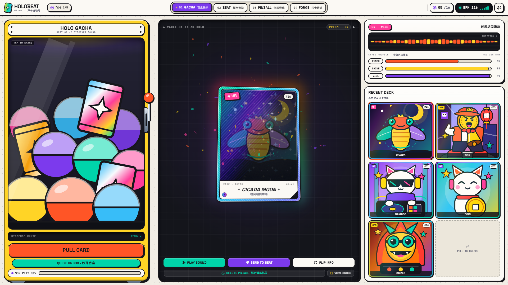 | 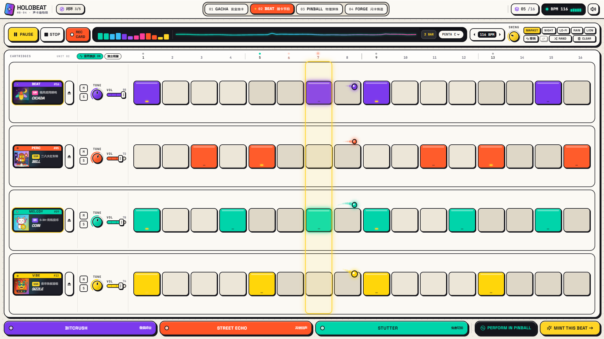 |
| **物理出球舱门 × 3D 光学折射闪卡 × 16 张东方市井原声** | **4 轨 16 步编曲 × Holo Motion 抛物线跳跃音符 × 5 组街头预置** |

| 03 PINBALL · 编曲剧场音画演出 | 04 FORGE · 声纹封印与藏品鉴赏 |
| :---: | :---: |
| 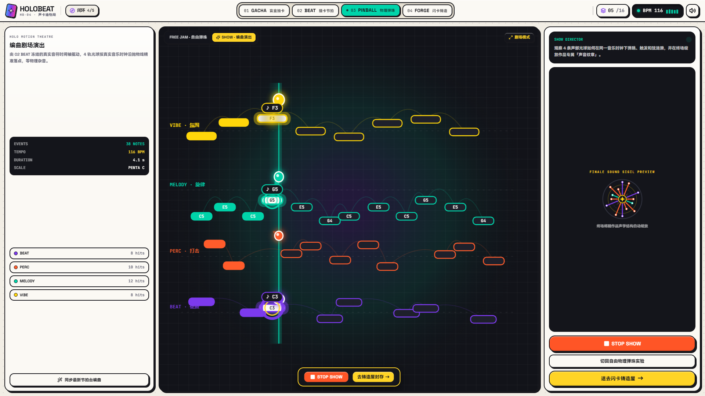 | 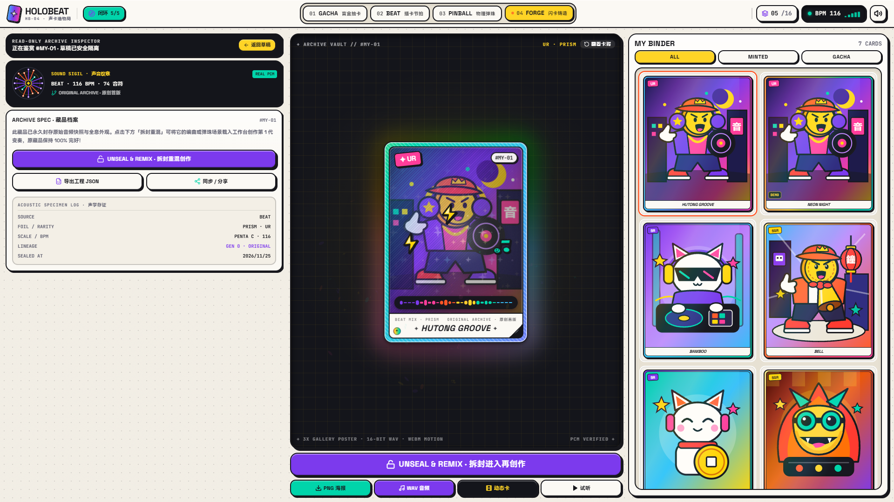 |
| **Choreographed Show 确定性乐谱剧场 × 4 轨光球 × 终场纹章** | **声音纹章 × 真实 PCM 声纹 × 7 阶段压印 × 拆封重混血统** |

---

## 2. 艺术概念与创意闭环

**HoloBeat** 不是四个割裂的小游戏，而是同一台掌上潮玩造物机中的四道完整工艺：

```text
01 GACHA (发现声音) ──▶ 02 BEAT (组织节奏 + Holo Motion) ──▶ 03 PINBALL (自由实验 / 编曲剧场)
       ▲                                  ▲                               │
       │                                  └──── 8s 录音幽灵量化回流 ───────┘
       │                                                                  ▼
   图鉴收藏 ◀──── UNSEAL & REMIX (拆封重混 · 衍生谱系) ◀──── 04 FORGE (声音纹章 + 真实 PCM 封印)
```

- **东方市井文化转译**：将弄堂竹板、二八大杠车铃、街机投币、夜市铁板滋啦、老式风扇、茶壶汽笛、雨打芭蕉、晚风胡同蝉鸣等 **16 种生活烟火声景**，全部转化为 100% 程序化离线合成的可演奏音色卡与原创矢量潮玩 IP 角色。
- **可触摸的器物美学**：在 Neo-Brutalism 硬朗轮廓之上注入 Teenage Engineering 与 Playdate 式的温润米白底盘、丝印参数标号、凹陷式 OLED 仪表盘与物理阻尼旋钮；全息闪卡在静止时保持高级印刷品的克制优雅，仅在鼠标倾角扫过时爆发多层黑谷折射光栅与碎钻星芒。

---

## 3. 核心交互亮点实拍

### 3.1 Holo Motion · 声音生命运动系统（节拍台 & 剧场演出）
受开源项目 **[Dancing Notes](https://github.com/SyanChen7/dancing-notes)**（MIT）的抛物线音乐时钟原理启发，我们在 `05_web_app/src/motion/holoMotion.ts` 中原创构建了面向 4 轨多声部编曲的实时运动学系统：
- 每颗音符光球的位置完全由 `Tone.Transport` 真实音频时钟解析计算：$y(p) = y_{\text{lerp}}(p) - 4 \cdot h \cdot p \cdot (1 - p)$，在 $p=0$ 与 $p=1$ 时精确落点于打击垫与舞台音高平台，**零漂移、支持实时调速、静音、独奏与循环回绕**。
- 四轨拥有独立物理性格：`BEAT`（厚重低频下砸）、`PERC`（清脆短弧快跳）、`MELODY`（高弧流体跃动）、`VIBE`（悬浮柔和辉光）。

### 3.2 物理弹珠双模式 & 8 秒录音幽灵量化回流
| 03 FREE JAM · 自由物理实验 + 8 秒彩点时间轴 | 02 QUANTIZE · 弹珠录音量化幽灵预览 |
| :---: | :---: |
| 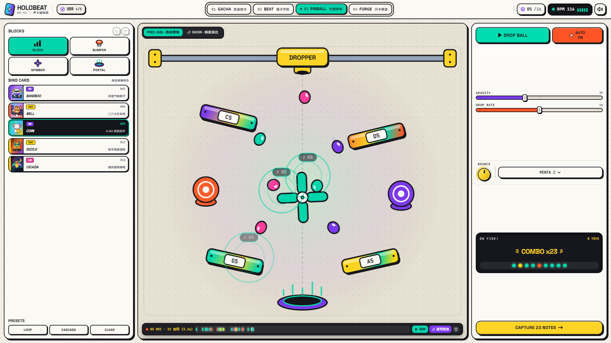 | 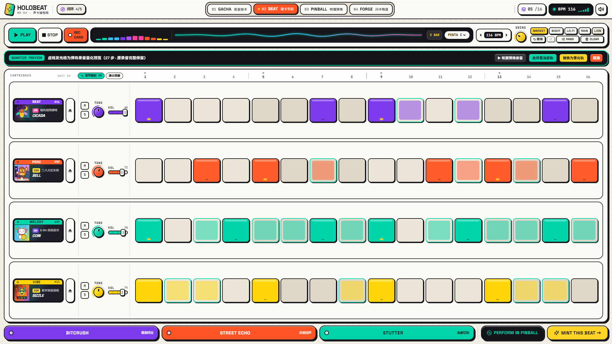 |
| **固定步长物理引擎 × 增量单刚体拖拽 × 分音色碰撞粒子 × 可见 8s 录音轨** | **保留原始弹珠录音可试听对比 × 虚线幽灵格预览 × 一键合并 / 替换 / 取消** |

### 3.3 声音纹章、真实 PCM 声纹与拆封重混（Unseal & Remix）
| 04 FORGE · 铸造草稿工作台（实时 PCM 声纹校验） | 02 REMIX · 拆封旧藏品衍生第 N 代变奏 |
| :---: | :---: |
| 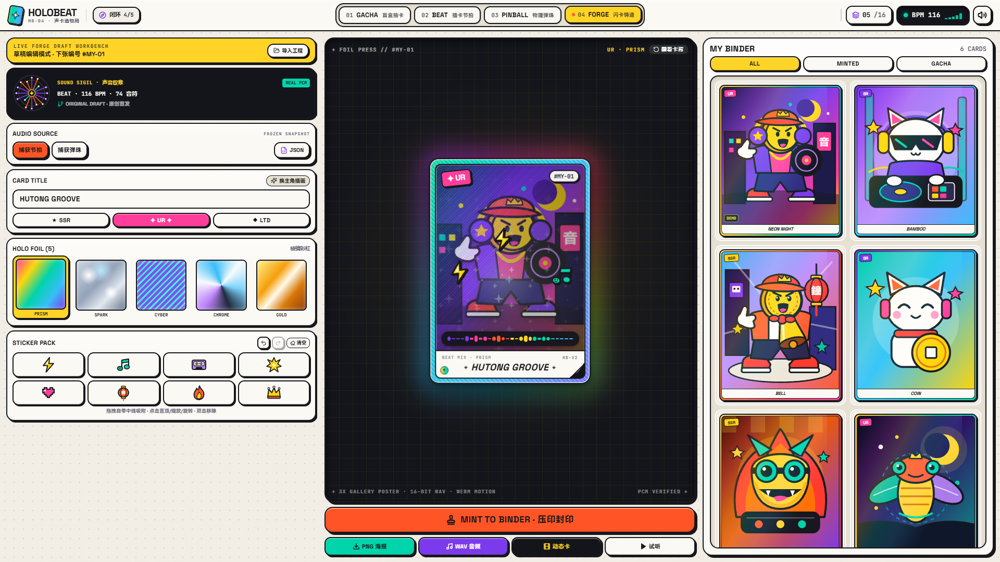 | 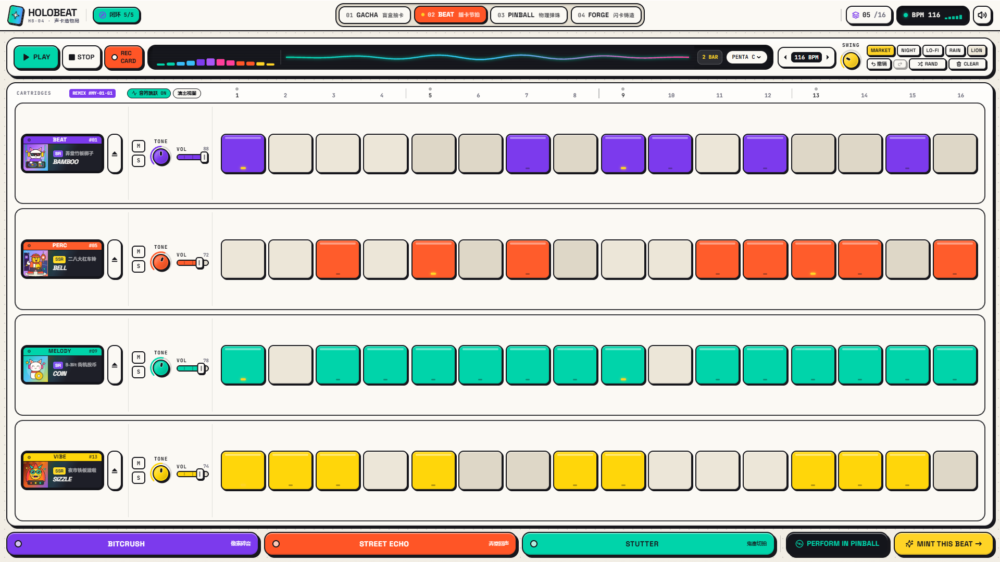 |
| **草稿与卡册只读鉴赏彻底隔离 × 5 种全息箔面 × 中心吸附贴纸撤销重做** | **拆封 `#MY-01` 进入编曲并标注 `REMIX #MY-01·G1`，原版藏品保持 100% 完好** |

---

## 4. 真实导出成品展示（100% 离线生成）

从 `04 FORGE` 可一键导出四种完整创作交付物（真实实测样品已全部收录于 [`07_showcase/exports/`](./07_showcase/exports/)）：

<div align="center">
  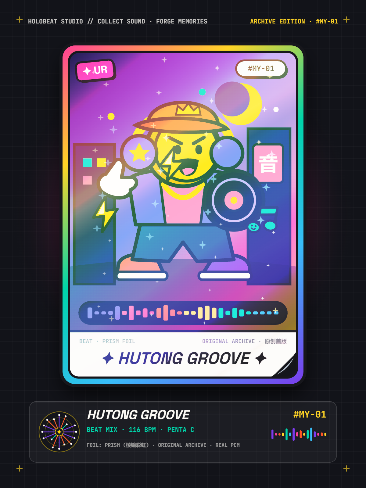
  <br />
  <sub><em>真实导出的 1200×1600 3× 展板级海报样品（含确定性声音纹章、真实 PCM 声纹条与藏品档案铭牌）</em></sub>
</div>

1. **展板级 3× 超清全息海报 PNG**（`1200×1600`）：自带暗黑展陈底板、十字定位丝印、5 种黑谷折射全息光层、确定性几何「声音纹章」与真实声纹铭牌。
2. **16-bit PCM 音频 WAV**（`48 kHz` 立体声）：通过 `Tone.Offline` 离线渲染，完整保留 `BitCrusher`、`Street Echo`（按 BPM 同步附点八分延迟）、`Stutter`、`Swing` 与重音力度，与网页试听 **100% 听感一致**。
3. **可重混工程文件 `.holobeat.json`**（`schema: holobeat.project.v2`）：完整保存作品快照、贴纸排版、箔面与衍生谱系，支持任意设备导入再创作。
4. **含原声全息动态卡 `.webm`**：基于原生 `Canvas.captureStream` + Web Audio `MediaStreamDestination` + `MediaRecorder` 实时录制含原声全息动态收藏卡。

---

## 5. V2.0 技术架构与数据闭环

```text
D:\HoloBeat
├── 01_github_research/     # 开源竞品与视觉交互调研基准
├── 02_product_design/      # 设计系统规范与产品架构文档
├── 03_gpt_ui_prompts/      # 概念视觉提示词探索记录
├── 04_ui_mockups/          # 早期概念原型设计稿（仅作演进溯源参考）
├── 05_web_app/             # 主交互 Web 工程（React 19 + TypeScript + Vite 6 + Tailwind v4）
│   ├── src/audio/          # Tone.js 离线程序化合成引擎、确定性编曲编译器、高一致 WAV 渲染器
│   ├── src/motion/         # Holo Motion 抛物线音画同步运动学引擎
│   ├── src/storage/        # IndexedDB (HoloBeatStudioDB) 持久化与旧数据安全备份层
│   ├── src/components/     # 3D 光学全息卡、声音纹章、刮刮乐、飞卡转场、机械旋钮与控件库
│   ├── src/pages/          # GachaPage / BeatDeckPage / PinballPage / ForgePage 四大工作台
│   ├── src/utils/          # 1200×1600 PNG 海报渲染、WebM 动态卡录制、可选后端客户端
│   ├── tests/              # Node 原生单元测试（核心音频编译 / 不可变快照 / 运动学 / 纹章）
│   └── scripts/            # Playwright 跨浏览器 E2E 验收与展示素材自动采集脚本
├── 06_backend/             # 可选轻量本地归档与只读分享后端（Fastify 5 + Zod + node:sqlite）
└── 07_showcase/            # V1/V2 真实对比截图、实导 PNG/WAV/JSON 样品、性能与测试实测报告
```

### 核心工程可靠性保障
- **不可变作品快照 (`CompositionSnapshot`)**：送往铸造或剧场的音乐立即深度冻结，后续清空或修改节拍台不会破坏草稿或已铸藏品。
- **单调编号与幂等铸造**：独立持久化 `nextMintSerial` + `mintInFlight` 锁 + 确定性 `idempotencyKey`，杜绝删卡后编号冲突与双击重复铸卡。
- **分层本地持久化**：轻量交互状态存 `localStorage`，作品档案、草稿与规范 WAV/PCM 声纹缓存存 `IndexedDB`，升级前自动留存 `holobeat-backup-pre-v3` 备份。
- **离线优先（Offline-First）**：所有字体（`@fontsource`）、矢量插画、程序化音色与导出渲染均 100% 本地闭环，零外部 CDN 依赖；即使不启动 `06_backend`，核心创作与收藏体验依然 100% 完整且控制台零报错。

---

## 6. 快速运行与本地开发

### 6.1 启动主交互应用（100% 纯前端离线运行）
> 环境要求：Node.js `>= 20`（运行原生 TypeScript 测试推荐 Node.js `24+`）

```bash
cd 05_web_app
npm install
npm run dev
```
打开浏览器访问 `http://localhost:5173`，点击顶部待机条 `POWER ON` 或「一键听 Demo」即可体验完整 4 大工作台！

### 6.2 生产构建与核心单元测试
```bash
cd 05_web_app
npm test        # 运行核心音频编译 / 不可变快照 / Holo Motion / 纹章单元测试
npm run build   # TypeScript 严格检查 + Vite 分包生产构建
```

### 6.3 可选：启动本地归档与分享后端（非必需）
```bash
cd 06_backend
npm install
npm test        # 运行 Fastify + SQLite 幂等存证、血统溯源与分享吊销测试
npm start       # 监听 http://127.0.0.1:3789
```

---

## 7. 设计演进溯源（概念稿 → V1.0 → V2.0 实机）

从早期视觉概念探索到 V2.0 完整工程落地，项目经历了「概念稿定调 (`04_ui_mockups/`) → V1.0 功能跑通 (`07_showcase/before/`) → V2.0 艺术与闭环深度重塑 (`07_showcase/screenshots/`)」三阶段演进：

| 阶段 | 早期概念视觉稿 (`04_ui_mockups`) | V1.0 实机基准 (`07_showcase/before`) | V2.0 终版实机 (`07_showcase/screenshots`) |
| :---: | :---: | :---: | :---: |
| **盲盒抽卡** |  | 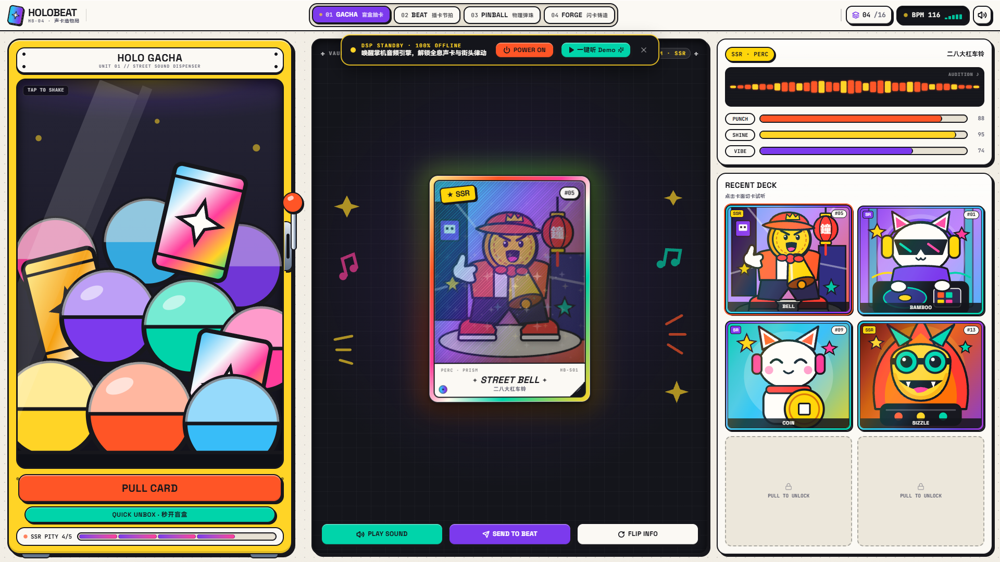 |  |
| **闪卡铸造** |  | 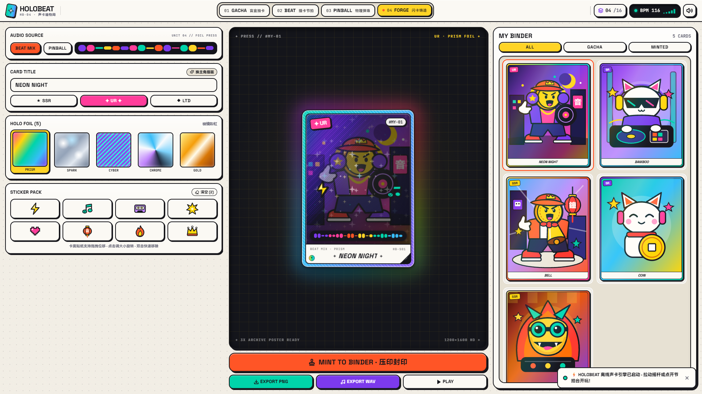 |  |

---

## 8. 质量验收与实测数据摘要

完整测试记录详见 **[《自动化测试、兼容性与性能验收报告》](./07_showcase/reports/test_and_perf_report.md)** 与 **[《V2.0 升级日志》](./07_showcase/reports/v2_upgrade_log.md)**：

- **自动化测试**：前端核心单测 **5 / 5 PASS**；可选后端 API 集成测试 **1 / 1 PASS**；Playwright 全闭环 E2E 验收 **全部通过**。
- **跨浏览器零报错**：**Google Chrome** 与 **Microsoft Edge** 实测均保持 **0 Console Errors / 0 Page Errors**。
- **多分辨率零溢出**：在 `1920×1080`、`1440×900`、`1366×768`、`1280×720` 四档屏幕 × 四大工作台（共 16 组视口组合）全部实测零水平/垂直溢出。
- **实测帧率**：`02 BEAT`（含 Holo Motion 4 轨跳跃音符与频谱示波器）实测 **`123.1 FPS`**；`03 PINBALL` Free Jam 物理碰撞实测 **`132.1 FPS`**。

---

## 9. 开源灵感致谢与竞赛匿名声明

- **Holo Motion 音画同步灵感致谢**：本项目中的 4 轨抛物线跳跃音符与编曲剧场演出运动机制，受开源项目 **[Dancing Notes (`SyanChen7/dancing-notes`)](https://github.com/SyanChen7/dancing-notes)**（MIT License）的音乐时钟抛物线轨迹原理启发，并针对多轨实时电子合成器、Mute/Solo、Swing 与物理剧场进行了独立原创架构重构。
- **光学全息卡层参考**：CSS 多层 `color-dodge` / `overlay` 全息光栅材质工艺参考了社区经典全息卡牌光学分层思路，并在静止克制态、倾角折射响应与 5 种材质分级上做了独立视觉定制。
- **竞赛规范声明**：本仓库所有源码、界面文案、导出海报、音频文件与说明文档均严格遵循竞赛匿名评审要求，不包含任何个人姓名或院校标识信息。
