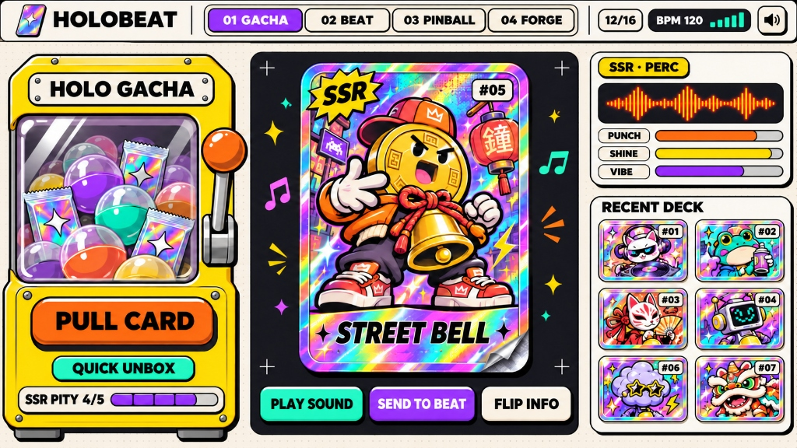

# HoloBeat · 声卡造物局

> **实体工业潮玩掌机 × 3D 光学全息闪卡 × 100% 纯前端离线互动声音玩具**

**HoloBeat（声卡造物局）** 是一款把东方市井烟火气与街头声音装进 **3D 光学全息可交互闪卡** 的纯前端 Web 互动声音产品。项目构建了 **「抽卡收集 → 插卡编曲 → 物理弹珠谱曲 → 闪卡铸造与展板级海报导出」** 的完整创作闭环，全程 **零后端、零外部音频/图片/字体外链**，断网环境亦可 60 FPS 流畅演奏与离线导出作品。

---

## ✨ 产品质感与四大交互工作台

| 工作台 | 核心体验与工艺亮点 |
| :--- | :--- |
| **`01 GACHA` 盲盒抽卡机** | Playdate / Teenage Engineering 风格注塑质感扭蛋机 + 重力堆叠透明橱窗 + 弹簧回弹棘轮大摇杆；Canvas 拉丝银膜全息刮刮乐（带实时刮开进度与飘落银屑物理粒子，刮开 ≥38% 自动破膜）；5 抽保底 `SSR/UR`；**胡克定律真弹簧 3D 倾斜**、六阶稀有度材质阶级（`N` 哑光纸感 → `R` 拉丝钛银 → `SR` 棱镜紫青 → `SSR` 烫金衍射 → `UR` 碎钻双层反向星芒 → `LTD` 碳黑蚀刻 24K 金）与 180° 翻卡查看瑞士网格声景档案。 |
| **`02 BEAT` 插卡节拍台** | 4 轨暗黑实体卡带插槽（带实时轨道触发 LED 与跨轨换卡混搭）、`M/S` 静音独奏、**270° 刻度环阻尼旋钮（支持滚轮与实时读数）**、带阻尼凹槽的硬件推子；4×16 交替四拍分组 MPC 打击垫（按住拖涂 + 节拍同步弹簧微震动）、视网膜高分屏彩虹 FFT/示波器 OLED；内建 3 组抓耳街头预置（`MARKET` 胡同早市 Funk / `NIGHT` 赛博夜市 Drift / `LO-FI` 茶馆爵士 Swing）与调式锁定和声进行，叠加三大现场 DJ 特效（`BITCRUSH` / `STREET ECHO` / `STUTTER`）。 |
| **`03 PINBALL` 物理弹珠琴** | 基于 `Matter.js` 刚体引擎 + `800×680` 等比高分屏全画幅弹珠台自绘渲染；自由摆放并拖拽 `BLOCK`（全息斜板）、`BUMPER`（带压缩弹簧回弹的蘑菇桩）、`SPINNER`（旋转风车）与 `PORTAL`（循环传送门），绑定任意已收集声卡；碰撞触发彗星流光拖尾、弹珠挤压形变、多层扩散波纹与漂浮音高徽章，支持 `COMBO` 升温等级与 8 秒滚动旋律录制直送铸造屋。 |
| **`04 FORGE` 闪卡铸造屋** | 将节拍混音或弹珠录轨封印为专属 `SSR / UR / LTD` 藏品闪卡；点击 **`MINT TO BINDER`** 触发激光热压覆膜扫描 + 收藏钢印砸落与礼花仪式；支持 5 种离线光学箔面（`PRISM` / `SPARK` / `CYBER` / `CHROME` / `GOLD`）、8 枚可拖拽缩放旋转的潮玩贴纸、原生离屏 Canvas 2D 导出 **展板级 3× 超清藏品海报 PNG（`1200×1600`）**、`Tone.Offline` 离线渲染导出 **16-bit PCM WAV**，以及基于 `localStorage` 的透明卡膜个人收藏册。 |

---

## 🎯 交互与音频引擎亮点

- **非侵入式硬件开机破冰**：首次打开页面顶部悬浮 `DSP STANDBY` 硬件开机条，点击 `POWER ON` 解锁浏览器音频并触发 4 音模拟掌机开机和弦，或点击 `一键听 Demo` 直达节拍台秒播「胡同早市 Funk」律动。
- **黑谷零泛白光学全息管线**：采用纯黑谷底彩虹衍射光栅（`color-dodge` 不洗白原画）+ 双层反向视差碎钻星芒（`UR / SPARK`）+ 边缘 3D 倒角流光，兼顾高对比度插画观感与真实实体闪卡折光手感。
- **带空间感与音乐性的程序化合成**：16 张原创市井声卡全部由 Tone.js 程序化合成，总线集成 `Freeverb` 轻度空间润色 + 动态压缩 + 限幅器，旋律与氛围轨内置三套调式和弦进行与律动轮廓，随手涂抹即成抓耳片段。

---

## 🖼️ 界面设计概念参考

| 01 盲盒抽卡机 (`GACHA`) | 02 插卡节拍台 (`BEAT DECK`) |
| :---: | :---: |
|  |  |

| 03 物理弹珠琴 (`PINBALL SYNTH`) | 04 闪卡铸造屋 (`CARD FORGE`) |
| :---: | :---: |
|  |  |

---

## 📂 项目目录结构

```text
HoloBeat/
├── README.md                                 # 项目总览与运行说明
├── .gitignore                                # Git 忽略规则（排除 node_modules / dist / 缓存等）
├── 01_github_research/
│   └── github_benchmark.md                   # 高星标杆项目技术拆解与纯前端离线架构报告
├── 02_product_design/
│   └── design_system.md                      # 4 页交互闭环架构与全站视觉交互设计规范
├── 03_gpt_ui_prompts/
│   └── ui_prompts.md                         # 逐页高保真视觉提示词与可交互控件清单
├── 04_ui_mockups/                            # 4 大工作台初始视觉概念参考稿
└── 05_web_app/                               # 前端核心工程（Vite + React 19 + TypeScript + Tailwind v4）
    ├── index.html
    ├── package.json
    ├── tsconfig.json
    ├── vite.config.ts
    └── src/
        ├── App.tsx                           # 应用主壳、无缝模块转场与全局开机破冰
        ├── main.tsx                          # React 入口
        ├── types/holo.ts                     # 全站数据结构与 TypeScript 类型定义
        ├── data/
        │   ├── soundCards.ts                 # 16 张原创市井全息声卡图鉴、5 种箔面与调式元数据
        │   └── stickers.ts                   # 8 枚原创潮玩矢量贴纸库
        ├── store/
        │   └── useHoloStore.ts               # Zustand + localStorage 跨页持久化状态总线与 3 组示范预置
        ├── audio/
        │   ├── HoloAudioEngine.ts            # Tone.js 程序化 16 声卡合成、和弦轮廓、空间总线与分析器
        │   ├── useHoloSfx.ts                 # 零素材硬件微触觉音效 Hook（含开机和弦/翻卡/热压印）
        │   └── wavExporter.ts                # Tone.Offline 离屏 16-bit PCM WAV 导出器
        ├── components/
        │   ├── artwork/CardArtwork.tsx       # 17 套原创三层视差街头潮玩矢量 SVG 角色资产
        │   ├── holo/HoloCard.tsx             # 真弹簧 3D 倾斜 × 6 阶稀有度 × 5 箔面全息闪卡组件
        │   ├── holo/ScratchOverlay.tsx       # 带实时刮开进度与飘落银屑粒子的拉丝全息刮刮乐
        │   ├── layout/TopNavbar.tsx          # 硬件丝印顶部导航、DSP 状态灯与实时 OLED 电平表
        │   └── ui/                           # AudioBootBanner / BrutalKnob / BrutalSlider / QuickDeckDrawer / ToastStack
        ├── pages/
        │   ├── GachaPage.tsx                 # 01 盲盒抽卡机工作台
        │   ├── BeatDeckPage.tsx              # 02 插卡节拍台工作台
        │   ├── PinballPage.tsx               # 03 物理弹珠琴工作台
        │   └── ForgePage.tsx                 # 04 闪卡铸造屋与个人收藏卡册工作台
        ├── styles/
        │   ├── index.css                     # 局部打包字体、微纸纹噪点、注塑面板与弹簧动效 Token
        │   └── holo.css                      # 黑谷零泛白衍射管线、碎钻反向星芒与六阶稀有度箔面系统
        └── utils/
            ├── confetti.ts                   # 预缓存自定义矢量路径礼花特效
            └── exportHoloPng.ts              # 离屏 Canvas 2D 展板级 3× 超清藏品海报 PNG（1200×1600）
```

---

## 🚀 本地安装与运行

### 环境要求
- Node.js >= 18（推荐 20+）
- npm >= 9

### 快速启动

```bash
# 1. 进入前端工程目录
cd 05_web_app

# 2. 安装依赖
npm install

# 3. 启动本地开发服务器（默认 http://localhost:5173）
npm run dev
```

### 生产构建与本地预览

```bash
cd 05_web_app

# TypeScript 类型检查 + Vite 离线生产打包
npm run build

# 预览打包产物
npm run preview
```

---

## 🛠️ 核心技术栈

- **框架与样式**：React 19 · TypeScript · Vite 6 · Tailwind CSS v4
- **音频合成与离线导出**：Tone.js（Web Audio API 程序化多音色合成 + `Freeverb` / `Compressor` 总线 + `Tone.Transport` + `Tone.Offline` WAV 导出）
- **物理引擎与图形渲染**：Matter.js · HTML5 Canvas 2D（等比高分屏渲染 & 1200×1600 展板级藏品海报 PNG 合成）
- **状态管理与交互动效**：Zustand（`persist` 本地持久化）· 胡克定律弹簧物理 rAF · `canvas-confetti` · `lucide-react`
- **100% 离线字体**：`@fontsource/space-grotesk` · `@fontsource/jetbrains-mono`
