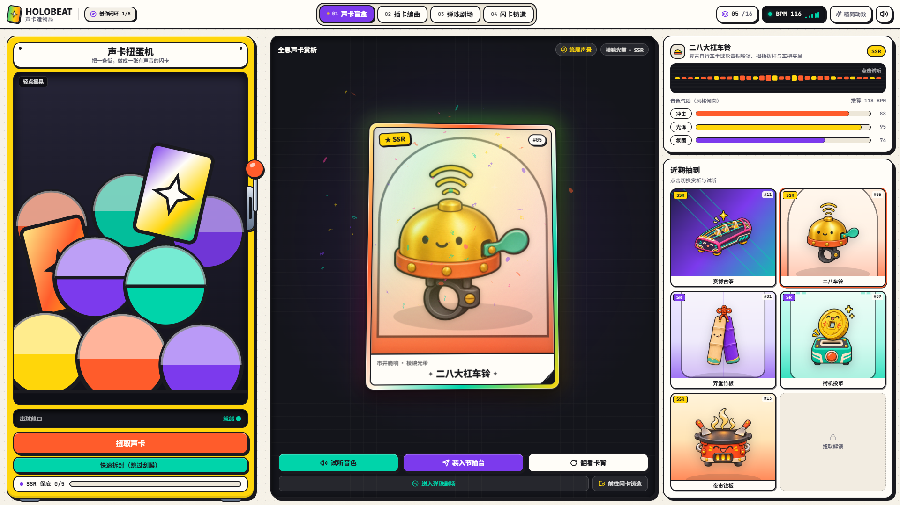
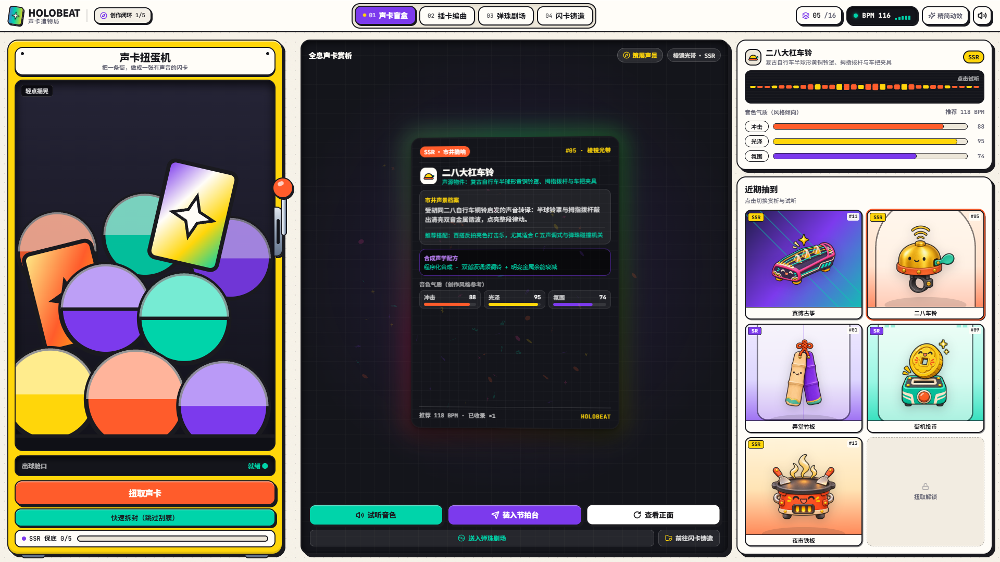
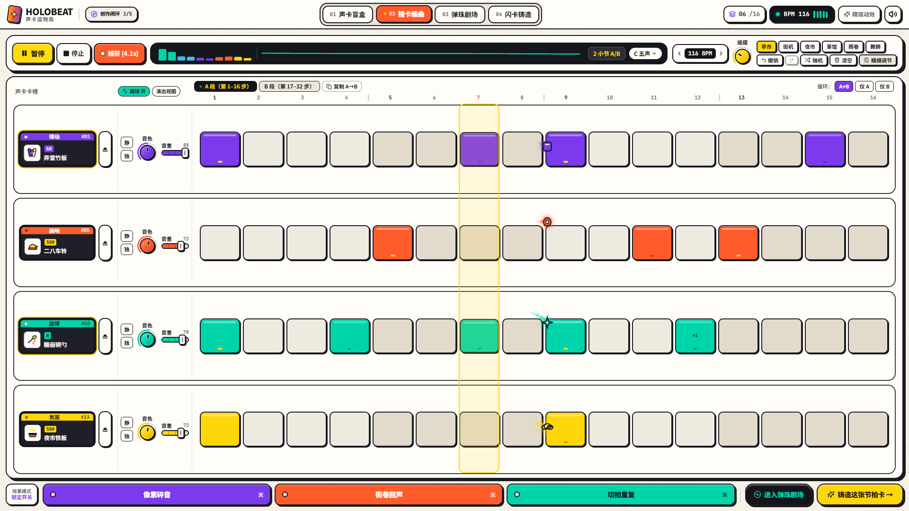
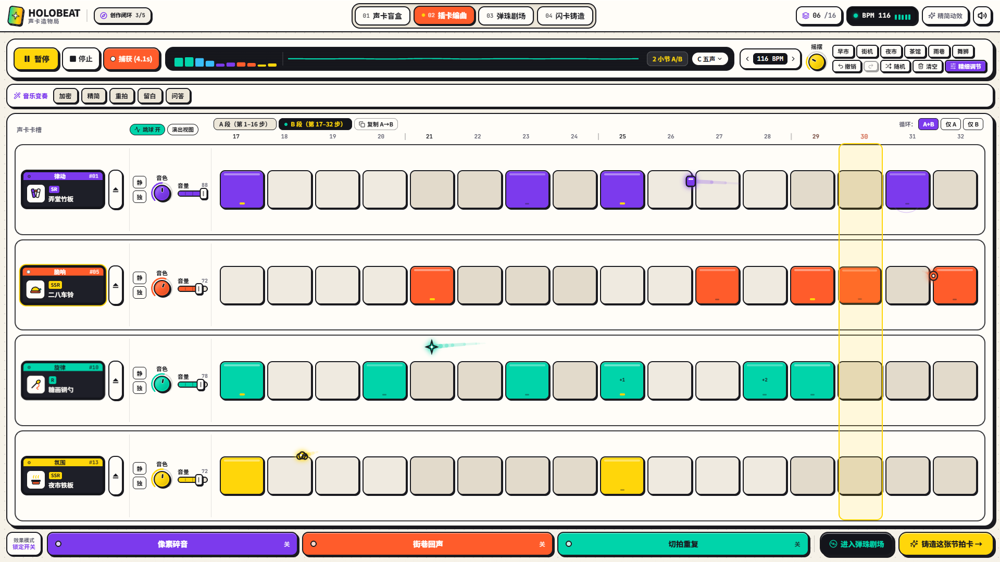
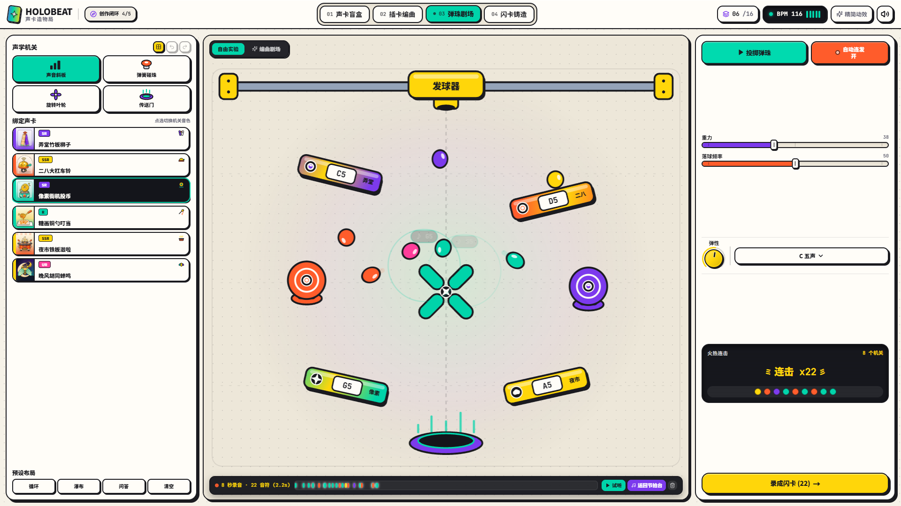
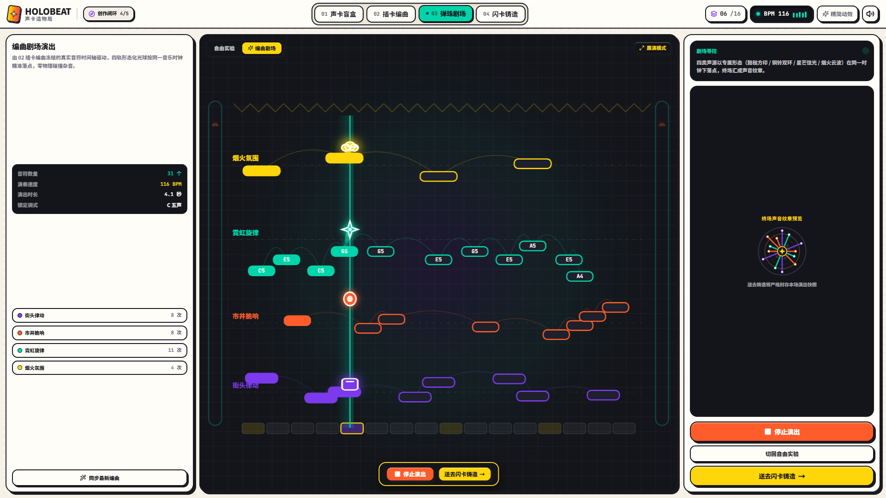
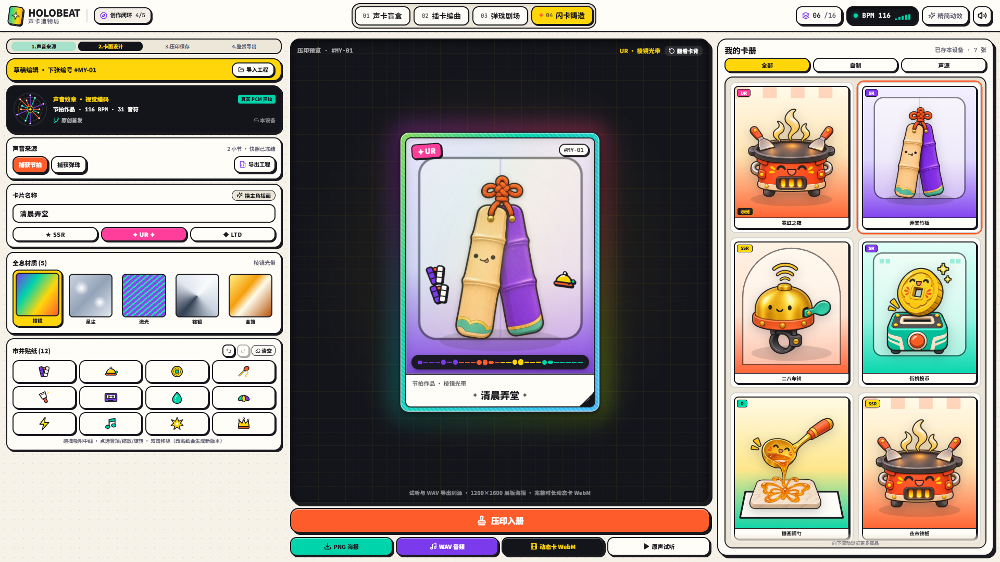
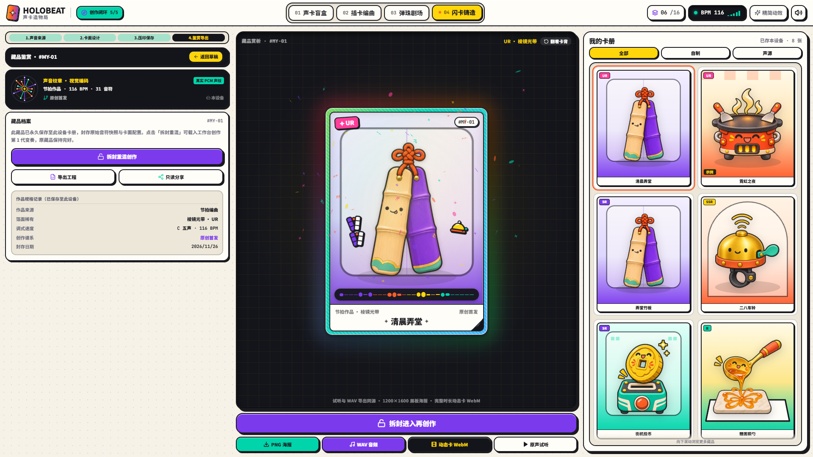
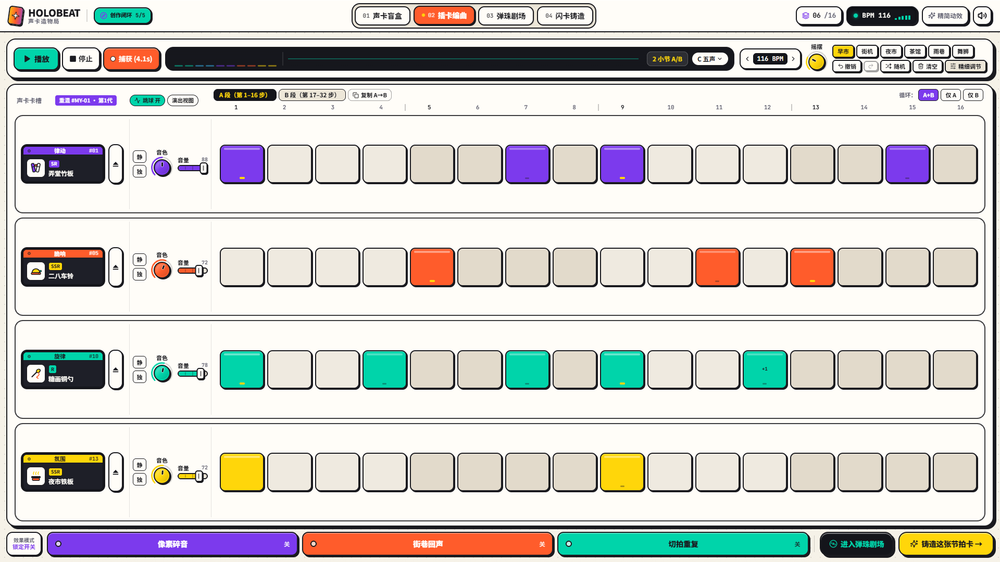
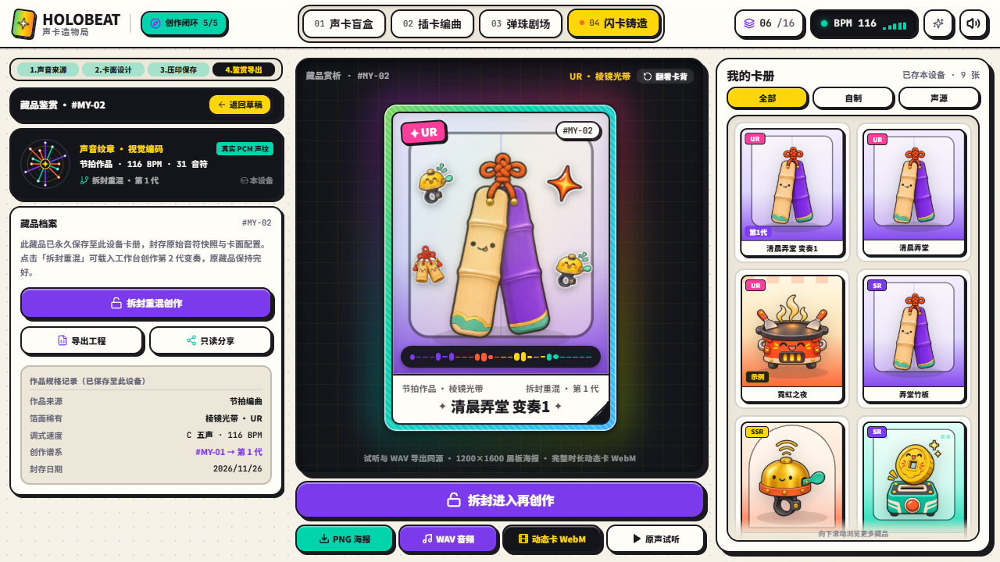

# HOLOBEAT · 声卡造物局

**把一条街，做成一张有声音的闪卡。**

**HOLOBEAT（声卡造物局）** 是一件融合「实体潮玩盲盒美学、中式日常市井声景转译、四轨步进编曲、物理弹珠音乐装置与可收藏全息数字闪卡」的 Web 原生数字媒体艺术互动系统（面向华灿奖数字媒体设计赛道深度打磨）。

> **音频与技术诚实声明**：本项目内置 16 张市井声卡与全部导出音频均采用 Web Audio API / Tone.js **程序化声音合成**（受中国街巷日常声景启发的声音转译，而非实地田野录音或非遗原声采样），支持 100% 本地离线运行，全部字体（Noto Sans SC / Space Grotesk / JetBrains Mono）均已本地打包，零在线外链依赖。

---

## 一、核心创作闭环：四工作台实景展示

> 以下 10 张均为最新 V3.2 版本的**真实浏览器运行截图**（全部 29 项 GPT Image 2 实绘声卡主角、哑光模切贴纸与微缩街巷舞台背景均已接入）。

### 01 声卡盲盒：街巷声源收集、翻背档案与策展声景
| 全息声卡赏析（标杆主角：二八大杠车铃） | 翻看卡背（声源小图标、市井档案与合成配方） |
| :---: | :---: |
|  |  |

### 02 插卡编曲：32 步独立 A/B 乐句、规则变奏与 Holo Motion 四形态跃动
| A/B 主创作界面与四形态音符跃动 | 规则约束「问答」变奏与 B 段展开 |
| :---: | :---: |
|  |  |

### 03 弹珠剧场：物理自由实验 + 微缩街巷编曲剧场
| 自由实验（机关绑定图标 + 8 秒实时录音轴） | 编曲剧场（微缩街巷装置边框 + 音乐时钟四轨精准落点） |
| :---: | :---: |
|  |  |

### 04 闪卡铸造：28/44/28 压印工坊、本设备持久化卡册与拆封重混
| 闪卡编辑态（4 步骤条 + 贴纸 + 真实 PCM 声纹） | 压印入册藏品鉴赏态（`#MY-01 清晨弄堂`） |
| :---: | :---: |
|  |  |

### 创作谱系拆封重混与 1280×720 紧凑单屏适配
| 拆封 `#MY-01` 进入第 1 代重混创作 | `1280 × 720` 紧凑视口完整单屏零溢出 |
| :---: | :---: |
|  |  |

---

## 二、同源代表作《清晨弄堂》（`#MY-01`）四格式导出样品

所有导出物均由同一份不可变 `CompositionSnapshot` 驱动，保证**试听声轨、真实 PCM 声纹、无损 WAV、展板海报、动态闪卡与可重混工程**完全同源：

- **高清展板海报 PNG（1200×1600，含声音纹章与真实声纹）**：[`07_showcase/exports/hutong-groove-gallery-poster.png`](./07_showcase/exports/hutong-groove-gallery-poster.png)
- **无损音频 WAV（48 kHz / 16-bit 立体声 / 5.018 s 含真实尾音）**：[`07_showcase/exports/hutong-groove.wav`](./07_showcase/exports/hutong-groove.wav)
- **完整时长动态闪卡 WebM（1.21 MB，支持录制中随时取消）**：[`07_showcase/exports/hutong-groove-motion.webm`](./07_showcase/exports/hutong-groove-motion.webm)
- **可重混工程文件 V3 JSON**：[`07_showcase/exports/hutong-groove.holobeat.json`](./07_showcase/exports/hutong-groove.holobeat.json)

---

## 三、快速本地启动与复现验证

### 1. 启动前端工作台（100% 离线可用，无需后端）
```bash
cd 05_web_app
npm install
npm run dev
# 访问 http://127.0.0.1:5173/
```

### 2. （可选）启动本地归档与只读分享展页后端
```bash
cd 06_backend
npm install
npm start
# 服务监听 http://127.0.0.1:3789/
# 同步藏品后可生成并浏览只读作品展页：http://127.0.0.1:3789/share/<token>
```

### 3. 运行全量自动化校验（单测 + 接口测试 + Playwright 严格 E2E）
```bash
# 前端类型检查、生产构建与 9 项核心引擎单测
cd 05_web_app && npm run build && npm test

# 后端类型检查与接口/嵌套校验/只读分享展页测试
cd 06_backend && npm run typecheck && npm test

# 启动前端（及可选后端）后运行严格 Playwright E2E、4 视口验收与截图导出
python 05_web_app/scripts/verify_and_capture.py
```

---

## 四、仓库目录结构

- [`02_product_design/design_system.md`](./02_product_design/design_system.md) — 视觉令牌、16 声源设定、Holo Motion 动效规范与参赛匿名自检清单
- [`05_web_app`](./05_web_app) — React + TypeScript + Vite + Tone.js + Matter.js 前端主工程与核心测试
- [`06_backend`](./06_backend) — 可选 Fastify + SQLite 本地归档与 `/share/:token` 只读作品展页服务
- [`07_showcase`](./07_showcase) — 10 张实景截图、4 格式同源代表作导出物与 [`test_and_perf_report.md`](./07_showcase/reports/test_and_perf_report.md)
- [`08_assets`](./08_assets) — 素材资产清单 [`manifest.json`](./08_assets/manifest.json)、29 项实绘源图与 WebP 产物、[`gpt_image_2_pack.md`](./08_assets/prompts/gpt_image_2_pack.md) 提示词规范与第三方开源许可清单
