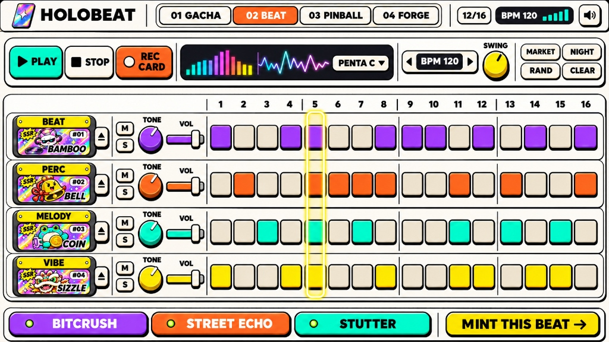
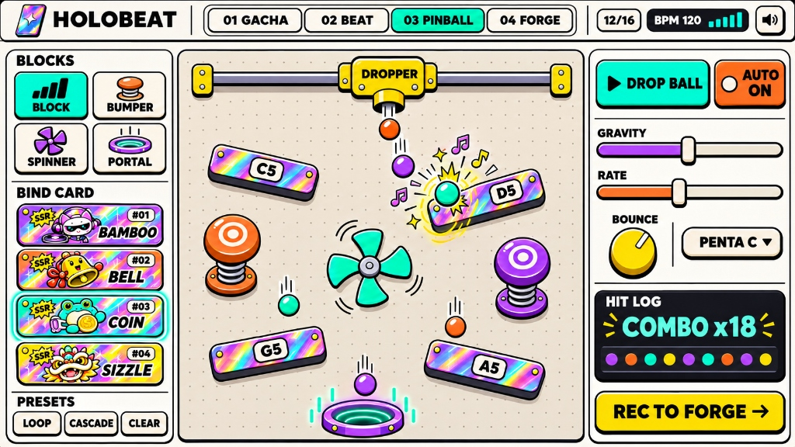
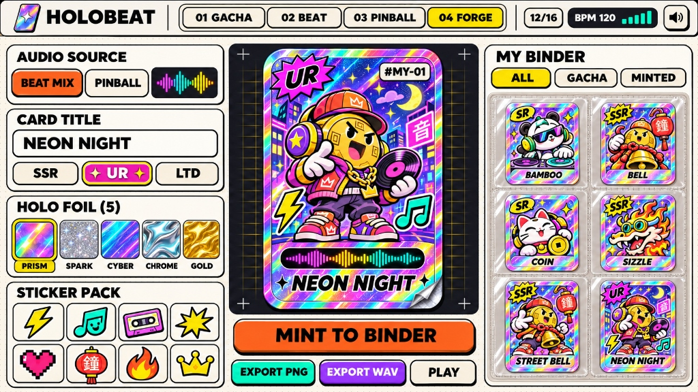

# HoloBeat · 声卡造物局

> **Neo-Brutalism 潮玩掌机实体面板 × 3D 彩虹全息镭射闪卡 · 100% 纯前端离线互动声音玩具**

**HoloBeat（声卡造物局）** 是一款把东方市井烟火气与街头声音装进 **3D 全息可交互闪卡** 的纯前端 Web 互动声音应用。项目构建了 **「抽卡收集 → 插卡编曲 → 物理弹珠谱曲 → 闪卡铸造与离线导出」** 的完整创作闭环，全程 **零后端、零外部音频/图片/字体外链**，断网环境亦可 60 FPS 流畅演奏与导出作品。

---

## ✨ 核心玩法与四大交互工作台

| 工作台 | 核心体验与技术亮点 |
| :--- | :--- |
| **`01 GACHA` 盲盒抽卡机** | 拟物潮玩扭蛋机与可拖拽棘轮大摇杆、Canvas 银色全息刮刮乐涂层（刮开 ≥42% 破膜并触发自定义音符/星芒礼花）、5 抽保底 `SSR/UR` 机制、零 React 重渲染 3D 指针倾斜与三层矢量视差赏卡、180° 翻卡查看市井档案与 Web Audio 合成公式。 |
| **`02 BEAT` 插卡节拍台** | 4 轨卡带式全息声卡插槽（支持弹出换卡与跨轨混搭）、`M/S` 静音独奏、`TONE` 滤波旋钮、`VOL` 平滑推子、支持按住拖涂的 4×16 发光打击垫矩阵、`Tone.Draw` 音画同步垂直播放头、实时彩虹 FFT/波形 OLED 屏、调式锁定（五声 C / 霓虹小调 / 都市爵士）与三大现场 DJ 特效（`BITCRUSH` / `STREET ECHO` / `STUTTER`）。 |
| **`03 PINBALL` 物理弹珠琴** | 基于 `Matter.js` 刚体世界 + 高分屏等比自绘新粗野 Canvas 2D 渲染器；自由摆放并拖拽 `BLOCK`（斜板）、`BUMPER`（高弹蘑菇桩）、`SPINNER`（旋转风车）与 `PORTAL`（循环传送门），绑定任意已收集声卡，碰撞触发 64 槽几何波纹/音符动效对象池，并支持 8 秒滚动旋律录制直送铸造屋。 |
| **`04 FORGE` 闪卡铸造屋** | 将节拍混音或弹珠录轨封印为专属 `UR / SSR / LTD` 全息作品卡；支持 5 种离线全息箔面（`PRISM` / `SPARK` / `CYBER` / `CHROME` / `GOLD`）、8 枚可拖拽缩放旋转的潮玩贴纸、原生离屏 Canvas 2D 双通道导出 **3× 超清全息 PNG（`960×1344`）**、`Tone.Offline` 离线渲染导出 **16-bit PCM WAV**，以及基于 `localStorage` 的个人透明收藏卡册。 |

---

## 🖼️ 界面设计预览

| 01 盲盒抽卡机 (`GACHA`) | 02 插卡节拍台 (`BEAT DECK`) |
| :---: | :---: |
|  |  |

| 03 物理弹珠琴 (`PINBALL SYNTH`) | 04 闪卡铸造屋 (`CARD FORGE`) |
| :---: | :---: |
|  |  |

---

## 📂 项目目录结构

```text
HoloBeat/
├── README.md                                 # 项目总览与运行说明
├── .gitignore                                # Git 忽略规则（排除 node_modules / dist / 缓存等）
├── 01_github_research/
│   └── github_benchmark.md                   # 高星标杆项目技术拆解与纯前端离线架构报告
├── 02_product_design/
│   └── design_system.md                      # 4 页交互闭环架构与全站 Neo-Brutalism × Holo 设计规范
├── 03_gpt_ui_prompts/
│   └── ui_prompts.md                         # 逐页高保真 UI 生图提示词与 1:1 可交互控件清单
├── 04_ui_mockups/
│   ├── 01_gacha.jpg                          # 页面 01 盲盒抽卡机视觉稿
│   ├── 02_beat_deck.jpg                      # 页面 02 插卡节拍台视觉稿
│   ├── 03_pinball_synth.jpg                  # 页面 03 物理弹珠琴视觉稿
│   └── 04_card_forge.jpg                     # 页面 04 闪卡铸造屋视觉稿
└── 05_web_app/                               # 前端核心工程（Vite + React 19 + TypeScript + Tailwind v4）
    ├── index.html
    ├── package.json
    ├── tsconfig.json
    ├── vite.config.ts
    └── src/
        ├── App.tsx                           # 应用主壳与 4 页工作台路由切换
        ├── main.tsx                          # React 入口
        ├── types/holo.ts                     # 全站数据结构与 TypeScript 类型定义
        ├── data/
        │   ├── soundCards.ts                 # 16 张原创市井全息声卡图鉴、5 种箔面与调式元数据
        │   └── stickers.ts                   # 8 枚原创潮玩矢量贴纸库
        ├── store/
        │   └── useHoloStore.ts               # Zustand + localStorage 跨页持久化状态总线
        ├── audio/
        │   ├── HoloAudioEngine.ts            # Tone.js 程序化 16 声卡合成引擎、步进器与实时分析器
        │   ├── useHoloSfx.ts                 # 零素材 UI 微触觉音效 Hook
        │   └── wavExporter.ts                # Tone.Offline 离屏 16-bit PCM WAV 导出器
        ├── components/
        │   ├── artwork/CardArtwork.tsx       # 17 套原创三层视差街头潮玩矢量 SVG 角色资产
        │   ├── holo/HoloCard.tsx             # 3D 指针倾斜 × 5 箔面全息闪卡组件（支持翻卡与贴纸编辑）
        │   ├── holo/ScratchOverlay.tsx       # 高性能 Canvas 刮刮乐涂层组件
        │   ├── layout/TopNavbar.tsx          # 全局锁定顶部导航栏与实时 OLED 电平监测
        │   └── ui/                           # BrutalKnob / BrutalSlider / QuickDeckDrawer / ToastStack
        ├── pages/
        │   ├── GachaPage.tsx                 # 01 盲盒抽卡机页面
        │   ├── BeatDeckPage.tsx              # 02 插卡节拍台页面
        │   ├── PinballPage.tsx               # 03 物理弹珠琴页面
        │   └── ForgePage.tsx                 # 04 闪卡铸造屋与个人卡册页面
        ├── styles/
        │   ├── index.css                     # Tailwind v4 入口、局部打包字体与新粗野设计 Token
        │   └── holo.css                      # 5 种离线全息箔面混合模式管线与动画样式
        └── utils/
            ├── confetti.ts                   # 预缓存自定义矢量路径礼花特效
            └── exportHoloPng.ts              # 离屏 Canvas 2D 双通道 3× 超清全息 PNG 导出器
```

---

## 🚀 本地安装与运行

### 环境要求
- Node.js >= 18（推荐 20+）
- npm >= 9

### 快速启动

```bash
# 1. 进入前端工程目录
cd 05_web_app

# 2. 安装依赖
npm install

# 3. 启动本地开发服务器（默认 http://localhost:5173）
npm run dev
```

### 生产构建与本地预览

```bash
cd 05_web_app

# TypeScript 类型检查 + Vite 离线生产打包
npm run build

# 预览打包产物
npm run preview
```

---

## 🛠️ 核心技术栈

- **框架与样式**：React 19 · TypeScript · Vite 6 · Tailwind CSS v4
- **音频合成与离线导出**：Tone.js（Web Audio API 程序化合成 + `Tone.Transport` + `Tone.Offline` WAV 渲染）
- **物理引擎与图形渲染**：Matter.js · HTML5 Canvas 2D（等比高分屏渲染 & 3× 双通道全息 PNG 合成）
- **状态管理与交互动效**：Zustand（`persist` 本地持久化）· `canvas-confetti` · `lucide-react`
- **100% 离线字体**：`@fontsource/space-grotesk` · `@fontsource/jetbrains-mono`
